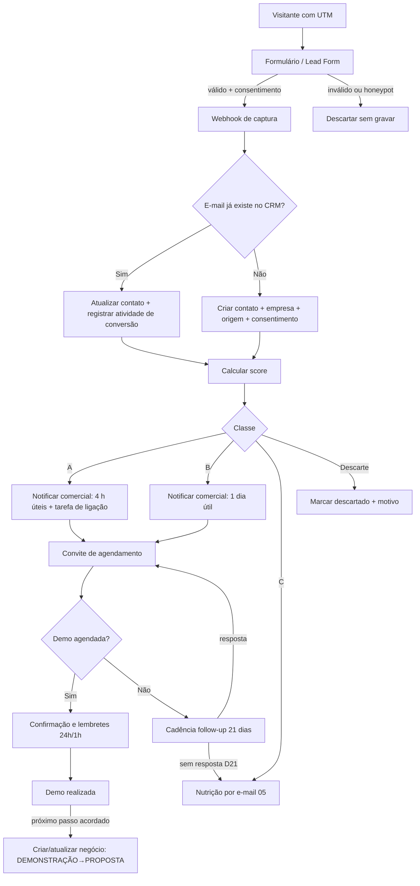
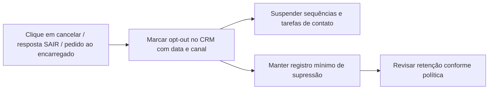
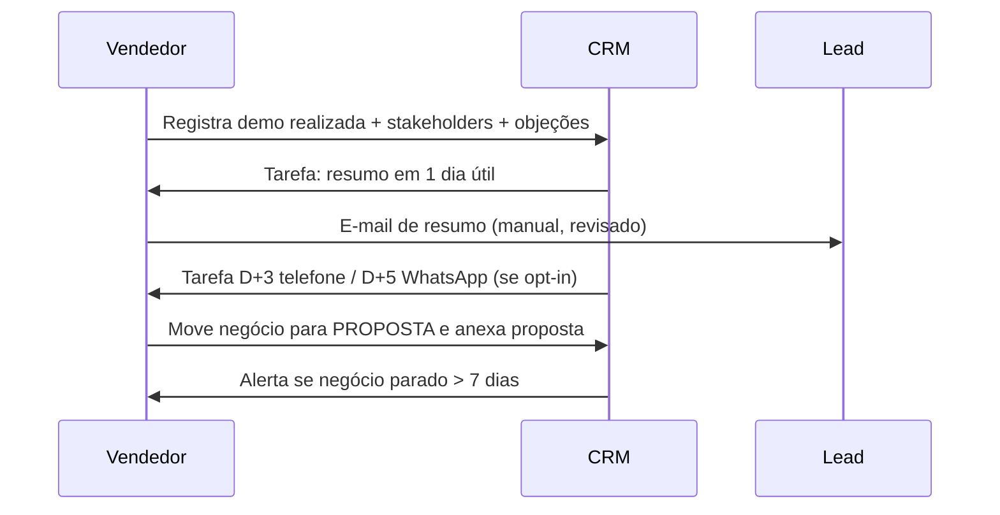

# Especificação de automações — captura → CRM → score → notificação → agendamento → follow-up → oportunidade
> Especificação **independente de ferramenta**. Nada foi contratado, configurado ou integrado. Implementação só após aprovação (`15_RELATORIOS/pendencias_e_aprovacoes.md`).

## Fluxo principal (Mermaid)

## Fluxo de consentimento e opt-out

## Fluxo de pós-demonstração e oportunidade

## Etapas e regras
| # | Etapa | Gatilho | Ação | Dados | Falha / exceção |
|---|---|---|---|---|---|
| 1 | Captura | Envio do formulário | POST ao webhook (ver `02_webhooks_utm_ga4.md`) | Campos do formulário + UTMs + consentimento | Retry 3x; fila de erro; alerta ao operador |
| 2 | Deduplicação | Novo payload | Chave: e-mail minúsculo | — | Conflito → atualizar sem sobrescrever campos preenchidos por humano |
| 3 | Enriquecimento | Contato criado | Normalizar nome/telefone; associar empresa pelo domínio | Domínio do e-mail | Sem enriquecimento externo (sem contratar serviços) |
| 4 | Score | Contato criado/atualizado | Regras de `10_LEAD_GENERATION/12_lead_scoring.csv` | Propriedades | Dados faltantes pontuam como "não informado" |
| 5 | Notificação | Classe A/B | E-mail/mensagem interna ao responsável (canal interno) | Resumo do lead | Fora do horário → primeira hora útil |
| 6 | Atribuição | Classe A/B | Round-robin ou por região/porte [A DEFINIR] | — | Sem responsável em 2 h → escalar |
| 7 | Agendamento | Contato SQL | Link de agenda no e-mail de resposta | — | Sem agendamento em 3 dias → cadência A |
| 8 | Follow-up | Sem resposta | Tarefas/sequência conforme `10/09_followup_comercial.md` | Atividades | Parar em resposta/opt-out |
| 9 | Oportunidade | Demo realizada | Criar negócio, definir estágio e próxima ação | Valor [A DEFINIR] | Negócio sem próxima ação → alerta |
| 10 | Higiene | Semanal | Relatório de negócios parados, leads sem dono, consentimentos ausentes | — | — |

## Requisitos transversais
- **Humano no loop**: nenhuma mensagem sai sem template aprovado; primeiros envios são revisados.
- **Consentimento antes de canal**: automação checa `consentimento_*` antes de qualquer envio.
- **Logs**: cada execução registra id, horário, resultado e erro (sem dados sensíveis).
- **Segredos**: chaves e tokens fora do código; nenhuma credencial neste repositório.
- **Ambiente de teste** com dados fictícios antes de produção.

## Arquivos relacionados
`fluxo_automacao.json` (definição genérica importável/adaptável), `02_webhooks_utm_ga4.md`, `03_comparativo_ferramentas.md`, `prototipo/`.
