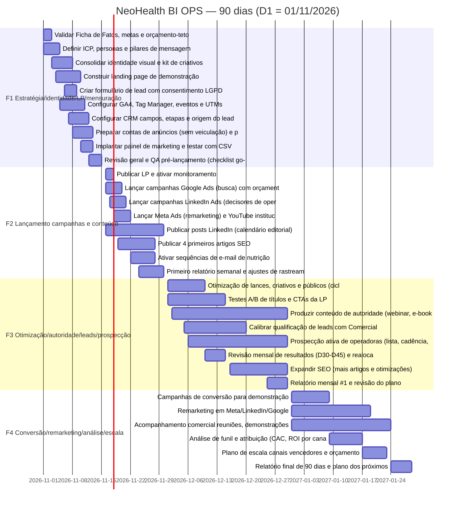

# Cronograma de 90 dias — NeoHealth BI · OPS

Data-base: **dia 1 = 01/11/2026**; dia 90 = 29/01/2027. Responsáveis são **funções** (nomes a definir [A CONFIRMAR]). Nada é publicado, disparado ou gasto sem o ponto de aprovação indicado. Fonte editável: `cronograma.csv`.

## F1 Estratégia/identidade/LP/mensuração (D1-15)

| ID | Dias | Datas | Tarefa | Responsável (função) | Depende de | Entregável | Aprovação | Critério de pronto |
|---|---|---|---|---|---|---|---|---|
| T01 | 1–3 | 01/11–03/11 | Validar Ficha de Fatos, metas e orçamento-teto | Gestão de Marketing + Proprietário | — | Ficha de Fatos e metas aprovadas | SIM — Proprietário | Metas, orçamento e regras de linguagem assinados [A CONFIRMAR] |
| T02 | 1–5 | 01/11–05/11 | Definir ICP, personas e pilares de mensagem | Estrategista de Conteúdo | T01 | Documento de ICP e mensagens | SIM — Gestão | ICP e 5 pilares revisados sem promessas de resultado |
| T03 | 3–8 | 03/11–08/11 | Consolidar identidade visual e kit de criativos base | Designer | T02 | Kit de marca e templates | SIM — Gestão | Paleta/tipografia do brief aplicadas; nota de dados fictícios nos criativos |
| T04 | 4–10 | 04/11–10/11 | Construir landing page de demonstração | Web/Desenvolvedor + Redator | T02;T03 | LP em homologação | SIM — Proprietário | LP com CTA 'Solicite uma demonstração', sem claims não comprovados |
| T05 | 6–9 | 06/11–09/11 | Criar formulário de lead com consentimento LGPD | Web/Desenvolvedor + Jurídico/DPO | T04 | Formulário com base legal e opt-out | SIM — Jurídico/DPO | Texto de consentimento aprovado; política de privacidade linkada [A CONFIRMAR] |
| T06 | 5–11 | 05/11–11/11 | Configurar GA4, Tag Manager, eventos e UTMs | Analista de Dados/Mensuração | T04 | Plano de medição e tags | SIM — Gestão | Eventos de formulário/CTA disparam em teste; convenção UTM documentada |
| T07 | 7–12 | 07/11–12/11 | Configurar CRM: campos, etapas e origem do lead | Operações Comerciais/CRM | T01;T05 | CRM com funil e campo de origem | SIM — Comercial | Etapas alinhadas ao CSV do painel; lead de teste registrado |
| T08 | 8–13 | 08/11–13/11 | Preparar contas de anúncios (sem veiculação) e pixels/Insight Tag | Analista de Mídia Paga | T06 | Contas e rastreadores prontos | SIM — Proprietário (meios de pagamento) | Rastreadores validados; nenhuma verba ativada |
| T09 | 10–13 | 10/11–13/11 | Implantar painel de marketing e testar com CSV | Analista de Dados/Mensuração | T06;T07 | Painel 13 em uso interno | NÃO | Painel carrega CSV real/template sem erros |
| T10 | 12–15 | 12/11–15/11 | Revisão geral e QA pré-lançamento (checklist go-live) | Gestão de Marketing + QA | T04;T05;T06;T08 | Checklist go-live preenchido | SIM — Proprietário (GO/NO-GO) | Todos itens obrigatórios do checklist OK |

## F2 Lançamento campanhas e conteúdo (D16-30)

| ID | Dias | Datas | Tarefa | Responsável (função) | Depende de | Entregável | Aprovação | Critério de pronto |
|---|---|---|---|---|---|---|---|---|
| T11 | 16–18 | 16/11–18/11 | Publicar LP e ativar monitoramento | Web/Desenvolvedor | T10 | LP em produção | SIM — Proprietário | LP no ar, formulário entrega lead ao CRM |
| T12 | 16–20 | 16/11–20/11 | Lançar campanhas Google Ads (busca) com orçamento aprovado | Analista de Mídia Paga | T10;T08 | Campanhas ativas | SIM — Proprietário (verba) | Campanhas conforme plano, termos negativos aplicados |
| T13 | 17–21 | 17/11–21/11 | Lançar campanhas LinkedIn Ads (decisores de operadoras) | Analista de Mídia Paga | T10;T08 | Campanhas ativas | SIM — Proprietário (verba) | Segmentação e criativos aprovados; textos sem promessa de economia |
| T14 | 18–22 | 18/11–22/11 | Lançar Meta Ads (remarketing) e YouTube institucional | Analista de Mídia Paga | T12;T13 | Campanhas ativas | SIM — Proprietário (verba) | Públicos de remarketing alimentados; nota de dados fictícios nos criativos |
| T15 | 16–30 | 16/11–30/11 | Publicar posts LinkedIn (calendário editorial) | Social Media/Conteúdo | T03 | Posts publicados 3x/semana | SIM — Gestão (lote semanal) | Cada post revisado contra a Ficha de Fatos |
| T16 | 19–28 | 19/11–28/11 | Publicar 4 primeiros artigos SEO | Redator/SEO | T02 | 4 artigos no ar | SIM — Gestão | Normas ANS com fonte oficial ou [VERIFICAR NA FONTE] |
| T17 | 22–28 | 22/11–28/11 | Ativar sequências de e-mail de nutrição | Automação/CRM | T07;T05 | Automações ativas | SIM — Jurídico/DPO | Opt-out funcional; só contatos com base legal |
| T18 | 24–30 | 24/11–30/11 | Primeiro relatório semanal e ajustes de rastreamento | Analista de Dados/Mensuração | T12;T13;T09 | Relatório semanal #1 | NÃO | Dados conciliados entre mídia, GA4 e CRM |

## F3 Otimização/autoridade/leads/prospecção (D31-60)

| ID | Dias | Datas | Tarefa | Responsável (função) | Depende de | Entregável | Aprovação | Critério de pronto |
|---|---|---|---|---|---|---|---|---|
| T19 | 31–40 | 01/12–10/12 | Otimização de lances, criativos e públicos (ciclo 1) | Analista de Mídia Paga | T17 | Registro de otimizações | SIM — Gestão (mudanças de orçamento) | Decisões baseadas no painel e nos semáforos |
| T20 | 31–45 | 01/12–15/12 | Testes A/B de títulos e CTAs da LP | Web + Analista de Dados | T11 | Resultado dos testes | NÃO | Teste com volume mínimo definido [A CONFIRMAR]; decisão documentada |
| T21 | 32–60 | 02/12–30/12 | Produzir conteúdo de autoridade (webinar, e-books, vídeos de módulos) | Estrategista de Conteúdo + Designer | T14;T15 | Peças de autoridade | SIM — Gestão | Funcionalidades citadas com status; sem clientes/depoimentos inventados |
| T22 | 35–50 | 05/12–20/12 | Calibrar qualificação de leads com Comercial | Operações Comerciais/CRM + Comercial | T17 | Critério de lead qualificado | SIM — Comercial | Critério único registrado no CRM e no dicionário |
| T23 | 36–60 | 06/12–30/12 | Prospecção ativa de operadoras (lista, cadência, scripts) | Comercial/SDR | T20;T16 | Cadência em execução | SIM — Jurídico/DPO (LGPD) | Lista com base legal; opt-out em todo contato |
| T24 | 40–45 | 10/12–15/12 | Revisão mensal de resultados (D30-D45) e realocação | Gestão de Marketing | T18 | Ata de realocação | SIM — Proprietário | Realocação aprovada antes de executar |
| T25 | 46–60 | 16/12–30/12 | Expandir SEO (mais artigos e otimizações) | Redator/SEO | T15 | Artigos adicionais | SIM — Gestão | Metadados e links internos conferidos |
| T26 | 55–60 | 25/12–30/12 | Relatório mensal #1 e revisão do plano | Analista de Dados/Mensuração | T22 | Relatório mensal | SIM — Proprietário | KPIs com fórmulas do dicionário |

## F4 Conversão/remarketing/análise/escala (D61-90)

| ID | Dias | Datas | Tarefa | Responsável (função) | Depende de | Entregável | Aprovação | Critério de pronto |
|---|---|---|---|---|---|---|---|---|
| T27 | 61–70 | 31/12–09/01 | Campanhas de conversão para demonstração | Analista de Mídia Paga | T22 | Campanhas de fundo de funil | SIM — Proprietário (verba) | Público quente definido; criativos aprovados |
| T28 | 61–80 | 31/12–19/01 | Remarketing em Meta/LinkedIn/Google | Analista de Mídia Paga | T24 | Remarketing ativo | SIM — Jurídico/DPO | Política de cookies/consentimento verificada |
| T29 | 61–85 | 31/12–24/01 | Acompanhamento comercial: reuniões, demonstrações, propostas | Comercial/SDR | T21 | Pipeline atualizado no CRM | NÃO | Etapas atualizadas semanalmente |
| T30 | 70–78 | 09/01–17/01 | Análise de funil e atribuição (CAC, ROI por canal) | Analista de Dados/Mensuração | T25;T26 | Análise de funil | SIM — Gestão | Limitações de atribuição documentadas |
| T31 | 78–84 | 17/01–23/01 | Plano de escala: canais vencedores e orçamento | Gestão de Marketing | T27 | Proposta de escala | SIM — Proprietário | Sem promessa de resultado; baseada em dados reais |
| T32 | 85–90 | 24/01–29/01 | Relatório final de 90 dias e plano dos próximos 90 | Gestão de Marketing + Analista de Dados | T27;T28 | Relatório final | SIM — Proprietário | Lições aprendidas e pendências registradas |

## Gantt (Mermaid)

## Checklist de go-live (marcar antes do GO/NO-GO — T10)

### Links
- [ ] Todos os links da LP, e-mails e anúncios abrem (sem 404) e levam à página correta
- [ ] UTMs presentes em todos os links de campanha, conforme convenção
- [ ] Links de política de privacidade e termos funcionam
- [ ] Redirecionamentos e página de agradecimento testados

### Formulários
- [ ] Envio de teste chega ao CRM com origem/UTM
- [ ] Validação de campos e mensagens de erro em português
- [ ] E-mail de confirmação/notificação interna funcionando
- [ ] Sem campos desnecessários ou dados de saúde pessoais

### Responsividade
- [ ] LP testada em celular, tablet e desktop (Chrome, Safari, Edge)
- [ ] Imagens, botões e formulário legíveis e clicáveis em 390 px
- [ ] Velocidade de carregamento aceitável [A CONFIRMAR meta]
- [ ] Contraste e navegação por teclado verificados

### Rastreamento
- [ ] GA4 recebe visualização de página e eventos (formulário, clique no CTA)
- [ ] Tag Manager publicado em versão revisada; pixels/Insight Tag disparam
- [ ] Conversões importadas/configuradas nas plataformas de mídia
- [ ] Painel (13) lê CSV de teste; campanhas e canais com nomes padronizados
- [ ] Consentimento de cookies bloqueia tags antes do aceite [A CONFIRMAR ferramenta]

### LGPD
- [ ] Base legal e texto de consentimento aprovados pelo Jurídico/DPO
- [ ] Opt-out/descadastro em todo e-mail e comunicação
- [ ] Política de privacidade e canal do titular publicados
- [ ] Sem dados de saúde pessoais; materiais com tela trazem a nota 'Imagem da plataforma com dados fictícios (base de demonstração)'
- [ ] Registro de operações de tratamento e retenção de leads definidos

### Conteúdo e aprovações
- [ ] Nenhum cliente, depoimento, certificação, integração ou resultado inventado
- [ ] Sem promessa de redução de sinistralidade/economia; normas ANS com fonte oficial ou [VERIFICAR NA FONTE]
- [ ] Orçamento e verbas aprovados pelo Proprietário antes de ativar campanhas

## Pendências
Ver `PENDENCIAS.md`.
